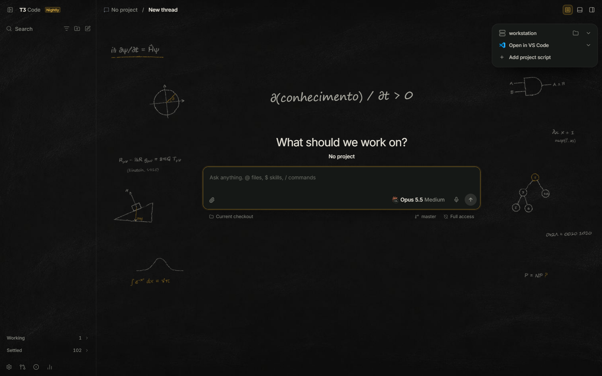
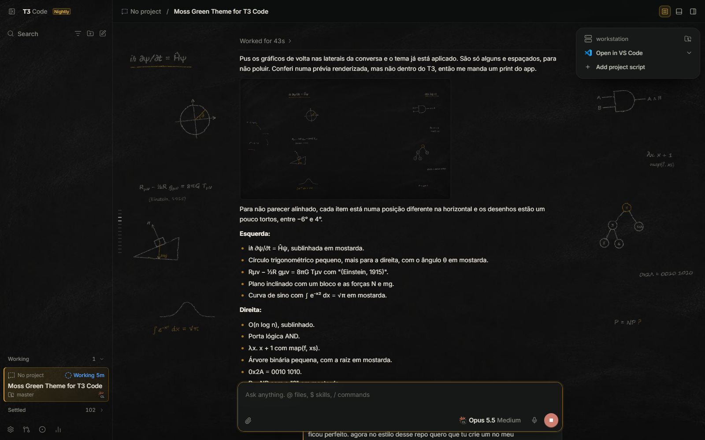
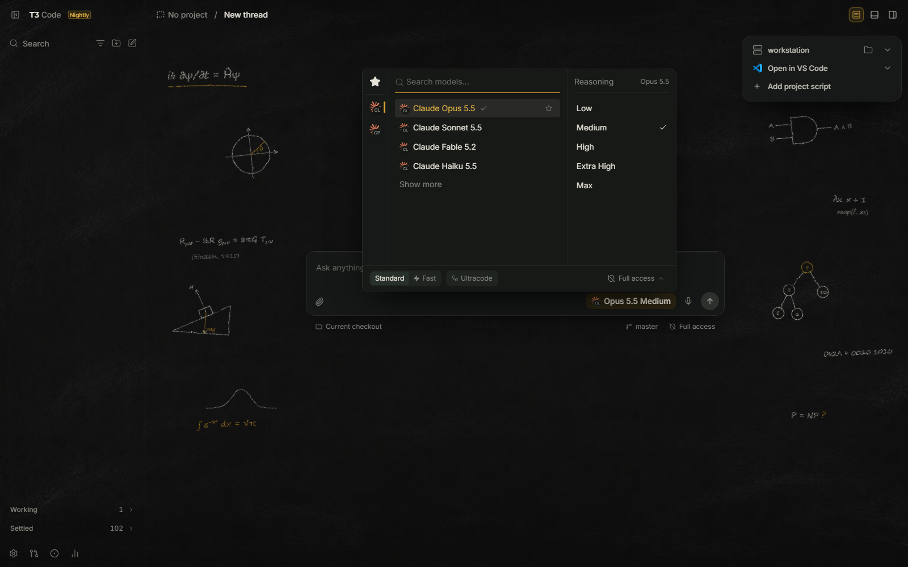
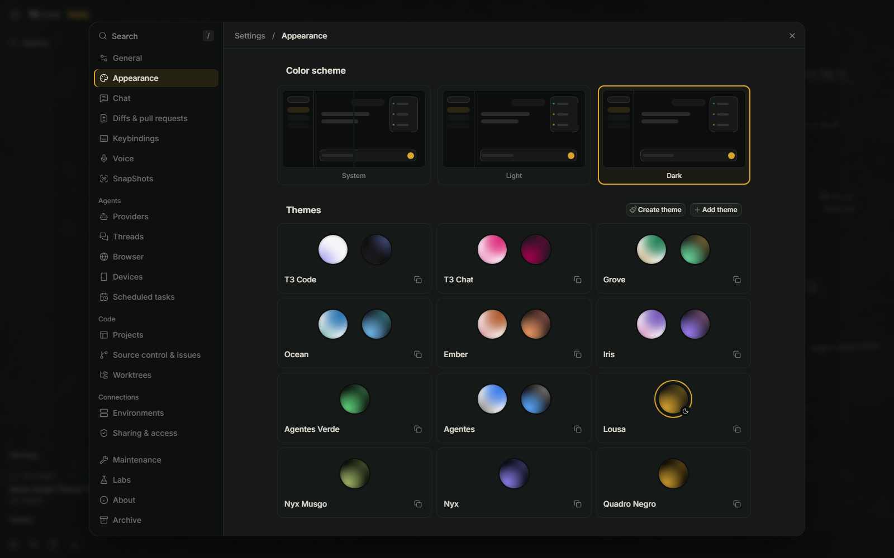
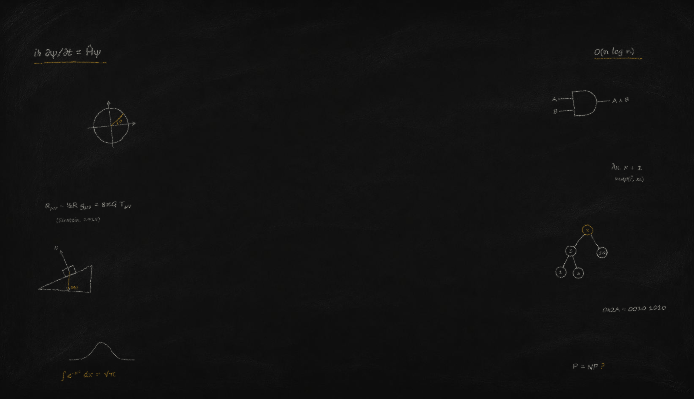

# Lousa

A university blackboard theme for [T3 Code](https://t3.codes). The background is a black chalkboard with faint eraser marks. A few equations and sketches are drawn in chalk beside your messages, in off-white and mustard, and never under the text.







## Install

```sh
curl -fsSL https://raw.githubusercontent.com/GabrielFarinela/t3-lousa-theme/main/lousa.json -o lousa.json
t3 theme set lousa.json
```

T3 switches to Lousa right away, in the desktop app and in the browser. To go back, pick another theme in the theme picker or run `t3 theme set t3-chat`.

### Let your agent install it

Paste this into a T3 Code thread:

> Install the Lousa theme from https://github.com/GabrielFarinela/t3-lousa-theme. Follow the "Instructions for agents" section of its README.

### Instructions for agents

1. Download `https://raw.githubusercontent.com/GabrielFarinela/t3-lousa-theme/main/lousa.json`.
2. If the `t3` command is available, run `t3 theme set <path to lousa.json>`.
3. Otherwise call the `t3_theme_set` tool with `themeId: "lousa"` and the file's JSON as `theme`.
4. Do not edit the file. The board texture and the drawings are inlined in it.

## Requirements

- A recent T3 Code Nightly (November 2026 or later).
- Works in the desktop app and the browser. The phone app doesn't use themes.

## Notes

- Lousa is dark only.
- The drawings sit in the free space on each side of the message column. They shrink with the window and hide when there isn't room: below about 1180px wide, with the side panel open, in Settings, and when the chat width is set to Full.
- The chalk handwriting uses Segoe Print, which ships with Windows. On other systems it falls back to Ink Free, Comic Sans MS or your system's cursive font.
- Messages, buttons and navigation keep T3's normal font. Only the decorations are handwritten.
- If a future T3 update changes its layout, a few small touches may fall back to T3's normal look. Nothing breaks.

## Change the theme yourself

`theme.css` holds the styles, `art.js` draws the chalk sketches, `board.jpg` is the board texture (AI-generated), and `build.js` puts them together into `lousa.json`. It needs only Node.js.

```sh
node build.js
```

## License

[MIT](LICENSE)
